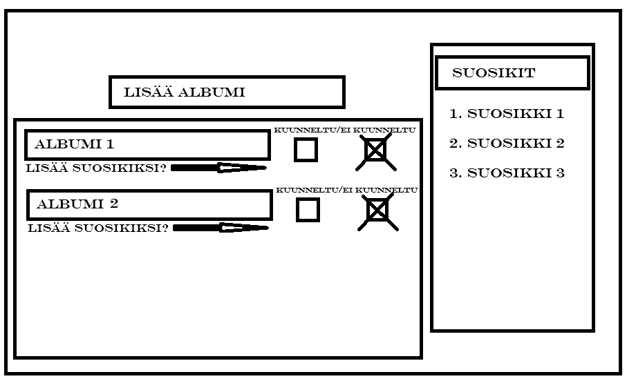
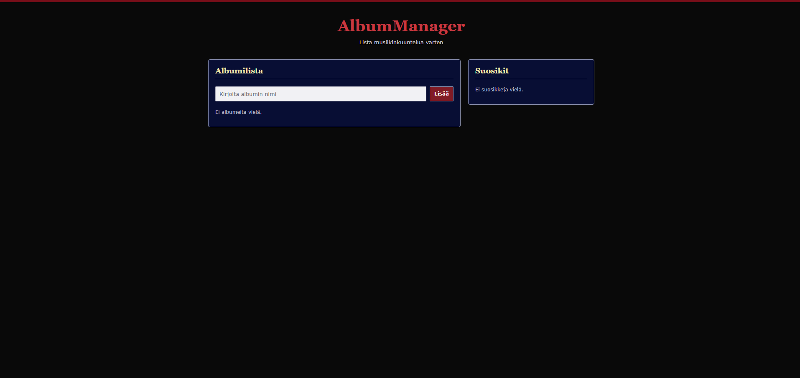
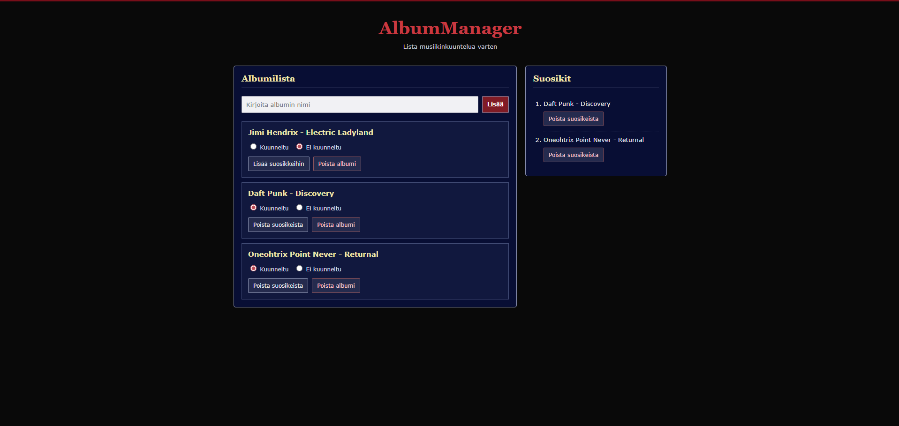

# AlbumManager

**Tekijä(t):** Elias Nieminen

## Projektisuunnitelma

### Projektin idea

Sovellukseni on käytännössä To Do -lista, jolla voit pitää kirjaa albumeista, joita olet kuunnelut, haluat kuunnella tai olet vielä kuuntelemassa.

### Suunnitellut toiminnot

Listaa vähintään kolme sovellukseesi suunniteltua toimintoa:

- Voit lisätä albumin listaan
- Voit poistaa albumin listalta
- Voit lisätä kuunnelun albumin suosikit -osioon.

### Rautalankamalli / luonnos

## Verkkolinkit

- **Julkaistu sovellus:** [Linkki GitHub sivustoon](https://vuorigorilla1.github.io/DOM-projekti-WebDev-syksy/)
- **GitHub-repositorio:** [Linkki repositorioon](https://github.com/vuorigorilla1/DOM-projekti-WebDev-syksy)
- **Projektin videoesittely:** [Linkki videoesittelyyn](https://example.com/)

## Tietoja sovelluksesta

**AlbumManager** on verkkosovellus, joka on tehty ihmisille, joilla on paljon albumeita kuunneltavana. Sovelluksen avulla et unohda kaikkia niitä albumeita, joita sinun on pitänyt kuunnella.

## Teknologiat

- HTML – sivun rakenne
- CSS – ulkoasu ja asettelu
- JavaScript – toiminnallisuus, DOM-skriptaus, lomakkeiden validointi ja LocalStorage

## Sovelluksen käyttö

Kirjoita lyhyet käyttöohjeet sovellukselle.

1. Avaa julkaistu sovellus yllä olevasta linkistä.
2. Kirjoita albumin nimi tekstikenttään.
3. Lisää, poista ja lisää suosikkeihin albumeita. Voit merkitä onko ne kunneltu vai ei. Suossikialbumeita voi myös poistaa.
4. LocalStorage tallentaa albumisi.

## Sovelluksen käynnistäminen paikallisesti

1. Kloonaa tai lataa tämä repositorio omalle koneellesi.
2. Avaa projektikansio.
3. Avaa `index.html` selaimessa.

## Kuvakaappaukset

Lisää tähän vähintään yksi kuvakaappaus toimivasta sovelluksestasi.

Esimerkki kuvan lisäämisestä:

## Tunnetut virheet / puutteet

**Ei tunnettuja virheitä.**

## Oma arvio ja oppimisen reflektointi

Pohdi työtäsi ja oppimisprosessiasi.

- Missä onnistuin? - Mielestäni onnistuin tekemään sen projektin minkä suunnittelin. 
- Mikä oli haastavaa? - Haastavaa oli saada kaikki JavaScript toimimaan oikealla tavalla. HTML ja CSS ovat minulle helppoja, mutta JavaScriptin ja sen yhteydessä DOM:in kanssa piti taistella.
- Mitä parantaisin, jos aikaa olisi enemmän? - Parantaisin toimivuutta. Lisäisin enemmän toimintoja kuten kuinka monta prosenttia albumia on kuunnelta, lisäisin listan mihin voisit laittaa kappaleet jne.
- Mitä opin HTML:stä, CSS:stä, JavaScriptistä ja DOM-skriptauksesta? HTML ja CSS taitoni kehittyivät vain vähän, mutta sanoisin, että tämä projekti edisti JavaScriptausta ja DOM-scriptausta. Tärkein mitä opin oli miten saan tiedot pysymään lomakkeissa. 
- Mikä jäi epäselväksi tai mistä haluaisin oppia lisää? - Itselleni ei jäänyt epäselvyyksiä.
- Oma arvio projektista: **8/10 pistettä**

## Lähteet ja kiitokset

- [Local Storage Explained In 10 min | Javascript](https://www.youtube.com/watch?v=fYTTUBa-lPc)
- [JSON.stringify()](https://developer.mozilla.org/en-US/docs/Web/JavaScript/Reference/Global_Objects/JSON/stringify)
- [Client-side storage](https://developer.mozilla.org/en-US/docs/Learn_web_development/Extensions/Client-side_APIs/Client-side_storage)
- [DOM scriptin introduction](https://developer.mozilla.org/en-US/docs/Learn_web_development/Core/Scripting/DOM_scripting)
- [Form and buttons in HTML](https://developer.mozilla.org/en-US/docs/Learn_web_development/Core/Structuring_content/HTML_forms)
- [Array.prototype.filter()](https://developer.mozilla.org/en-US/docs/Web/JavaScript/Reference/Global_Objects/Array/filter)
- [JavaScript Full Course for free 🌐](https://www.youtube.com/watch?v=lfmg-EJ8gm4)
- Käytetty tekoälytyökalu: ChatGPT
  - Miten työkalua käytettiin: Käytin GPT:tä jos jäin JavaScriptissä jumiin ja koodin tarkastamiseen virheiden varalta. Käytin sitä myös sivun skaalautuvuutta varten.

  ## Lisenssi

Tämä projekti on lisensoitu MIT-lisenssillä.